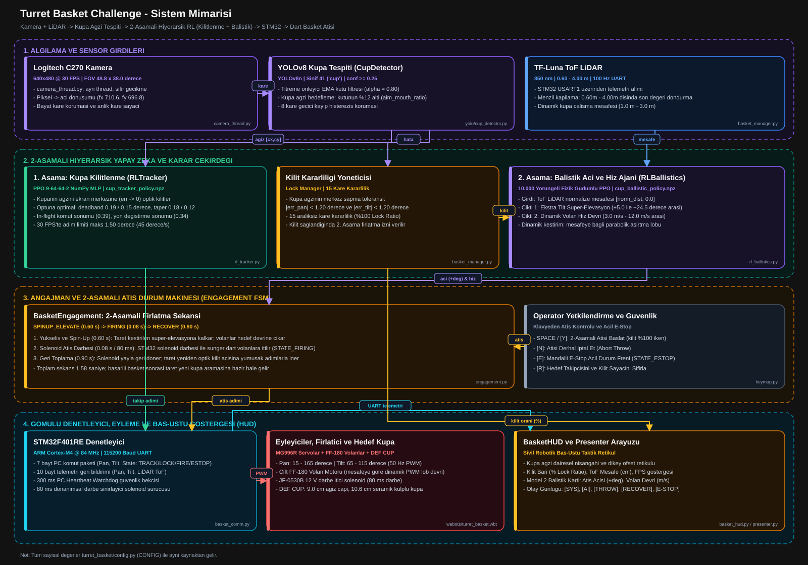
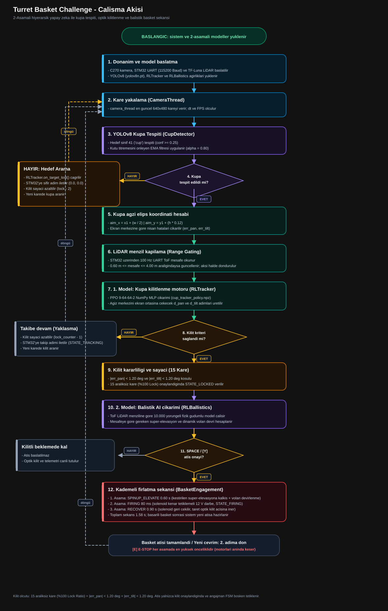

# Basket Challenge: Turret FCS Kulplu Kupaya Basket Atma Projesi

Bu proje; otonom pan-tilt tareti kullanarak masada duran kulplu bir kupaya (mug) dart ile basket atma gorevini gerceklestiren 2 asamali hiyerarsik RL sistemidir.

---

## 1. Hiyerarşik Sistem Mimarisi



1. **1. Model (Görsel Kilitlenme - CupTracker):**
   * Dosya: [rl_tracker.py](file:///c:/YTU/turret-fcs/turret_basket/rl_tracker.py) & [cup_tracker_policy.npz](file:///c:/YTU/turret-fcs/turret_basket/rl/models/cup_tracker_policy.npz)
   * `turret_fcs` projesinde eğitilen 9-64-64-2 NumPy PPO modelini kullanır.
   * Kameradan kupayı yakaladığı anda tareti kupa ağzı elipsinin merkezine (`aim_mouth_ratio = 0.12`) optik olarak kilitler (`err_x -> 0`, `err_y -> 0`).
2. **2. Model (Balistik Açı ve Volan Hızı Karar Ajanı):**
   * Dosya: [rl_ballistics.py](file:///c:/YTU/turret-fcs/turret_basket/rl_ballistics.py) & [cup_ballistic_policy.npz](file:///c:/YTU/turret-fcs/turret_basket/rl/models/cup_ballistic_policy.npz)
   * Ortam: [cup_env.py](file:///c:/YTU/turret-fcs/turret_basket/rl/cup_env.py) (`BallisticBasketEnv`)
   * Eğitim Betiği: [train_rl.py](file:///c:/YTU/turret-fcs/turret_basket/rl/train_rl.py)
   * Hedef kilitlendiğinde LiDAR mesafesini (0.60m - 4.00m) alır; dartın kupanın ağzından içeriye basket olması için gereken:
     * **Ekstra Tilt Atış Açısını (Süper-elevasyon: +5.0° ile +24.5° arası)**
     * **Dinamik Volan Sürücü Hızını (3.0 m/s ile 12.0 m/s arası dinamik lob hızı)**
     birlikte optimize eder.

---

## 2. Çalışma Akışı ve Angajman Durum Makinesi



### Kademeli Fırlatma Zaman Çizelgesi (BasketEngagement)

```text
[SPACE / Y] ──> SPINUP_ELEVATE (0.60 s)
                  │  taret kestirilen süper-elevasyon açısına yükselir, volanlar hedef devrine çıkar
                  v
                FIRING (80 ms / 0.08 s)
                  │  STM32 kenar tetiklemeli 12 V darbe ile solenoidi iter, dart volanlara beslenir
                  v
                RECOVER (0.90 s)
                  │  solenoid yayla geri çekilir, taret optik kilit açısına yumuşak adımlarla iner
                  v
                COMPLETED (toplam 1.58 s)
                     yeni kupa aranır ve sistem anında sıradaki basket atışına hazır hale gelir
```

---

## 3. Webots Dünyası ve Kontrolcüsü

* **Dünya Dosyası:** [webots/worlds/turret_basket.wbt](file:///c:/YTU/turret-fcs/webots/worlds/turret_basket.wbt)
  * Aynı taret (MG996R servo torkları, C270 kamera, TF-Luna LiDAR, fırçasız çift volan motorları ve solenoid).
  * Masanın karşısında içi boş kulplu seramik kupa (`DEF CUP`).
  * Kupanın dibinde temas algılayıcı (`cup_basket_sensor TouchSensor`).
* **Kontrolcü:** [webots_turret_basket.py](file:///c:/YTU/turret-fcs/webots/controllers/webots_turret_basket/webots_turret_basket.py)
  * 1. Model ile kupaya kilitlenir.
  * 2. Modelden gelen süper-elevasyon açısı ve dinamik volan hızıyla basket atışını icra eder.
  * Ekrana modern bilgilendirici [basket_hud.py](file:///c:/YTU/turret-fcs/turret_basket/basket_hud.py) arayüzünü canlı basar.

---

## 4. Nasıl Çalıştırılır?

### Adım 1: Webots'ta Test Etme
Webots R2025a üzerinden `webots/worlds/turret_basket.wbt` dosyasını açıp simülasyonu başlatın.
* **SPACE:** Dart fırlatır.
* **R:** Kupayı masada rastgele yeni bir mesafeye taşır (1.3m - 2.7m).

### Adım 2: 2. Modeli Eğitme
LiDAR mesafesine göre Tilt açısı ve volan sürücü devrini öğrenen 2. Modeli eğitmek için:
```powershell
python turret_basket/rl/train_rl.py 50000
```

### Adım 3: Gerçek Donanımı Çalıştırma (Real Hardware Main)
Gerçek STM32 taretini ve C270 kamerayı bağlayıp masadaki kupaya basket atmak için ana giriş noktası:
```powershell
python turret_basket/main.py
```
* **SPACE / Y:** 2 Aşamalı Atışı Başlatır (Yükselme -> 600 ms Spin-up/Settle -> 80 ms Solenoid -> Geri Dönüş).
* **N:** Atışı İptal Eder.
* **E:** E-Stop Acil Fren.
* **R:** Hedef Takipçisini Sıfırlar.
* **Q / ESC:** Güvenli Çıkış.
